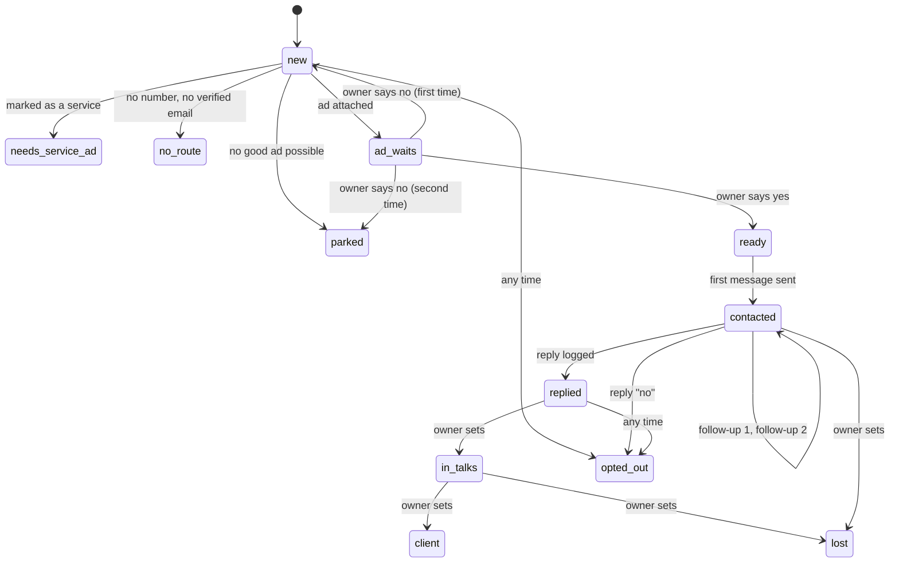

# Outreach CRM - Plan

## Goal Capsule

- **Objective:** On each working day the owner opens one page of the dashboard, on his phone or his laptop, and sees who to write to today, the ad made for that brand, and the message to send. He sends each message by hand, records it with one tap, and the studio keeps every brand's history, its follow-up dates, its replies and its opt-out. No brand that said no is ever shown to him again.
- **Means:** A new outreach part of the same AWS studio: prospects in the same table, owner-only pages, and tools for the agent that makes the ads (KTD1, KTD5, KTD7). No new provider and no sending service.
- **Product authority:** Han, the owner. He sends every message himself, says yes or no to each ad before it can be sent, and owns the message text. The agent makes the ads and chooses the kind (v1, v2 or v3) for each brand.
- **Execution profile:** One pull request (PR12) on top of PR #11. After it is merged and deployed, an operational run: load the list, make ads for a pilot of three brands, measure the cost, then go on to fifty.
- **Who finishes and ships:** The agent builds, tests, deploys and merges under the standing rule (checks, CI and review clean). The owner's steps are his look at each ad and the sending.
- **Stop conditions:** Stop at the campaign cap (R27). Stop the ad run when the measured cost of the pilot is above the target of R28 and no cheaper method holds the quality. Never send a message. Never write a contact detail or a line of the owner's message text into the repository.
- **Open blockers:** None. PR #6 to PR #11 are merged (22-11-2026). The owner's decision of 22-11-2026: the CRM and the outreach ads come after v1, v2 and v3.

---

## Product Contract

### Summary

The owner has a private list of Singapore brands that already run Meta ads, with a first message and two follow-ups. He will send at most five first messages on a working day, by hand, from his own Gmail and his own WhatsApp Business. The first message carries an ad made for that brand. This plan adds what he needs to do that every day without a spreadsheet: the list inside the dashboard, an ad for each brand worth one, a daily page, the history of each brand, and the numbers that say if it works.

### Problem Frame

The list is a spreadsheet with empty tracking columns. A spreadsheet does not say who is due today, does not hold the ad beside the message, does not stop a second message to a brand that opted out, and is hard to use on a phone, where the WhatsApp messages are sent. The owner is new to cold outreach, so the tool must carry the method: a fixed daily number, follow-ups on their dates, a reply never left without an answer, an opt-out that is final.

The studio can already make the ad. It cannot yet make one without the owner at three gates (words, concept pick, draft pick), and it counts every paid call against a monthly cap that is smaller than this campaign.

### Actors

- A1. The owner. Sees and changes everything in the outreach part.
- A2. The agent (the owner's MCP client). Loads the list, marks what a brand sells, makes ads, attaches them. Sees no contact detail.
- A3. A member of the studio. Sees nothing of the outreach part.
- A4. The prospect. Never touches the system. Receives only what the owner sends.

### Requirements

**The list**
- R1. A prospect holds what the list gives: its number in the list, brand, sector, live ads, spend tier, newest ad, best and second route, WhatsApp, verified email, phone, Instagram, decision-maker with title, LinkedIn. The list's order is the owner's order of priority.
- R2. The load can be run again. It adds new rows and updates the list's own fields. It never changes or removes a history, an ad, an opt-out or a note.
- R3. Prospect data lives only in the private table behind the owner's sign-in. The repository, the logs and the test fixtures hold no real contact detail and no line of the owner's message text.
- R4. A prospect is one of: product brand, service brand, or not yet known. A service brand shows as "needs a service ad" and gets no ad for now.
- R5. A prospect with no WhatsApp number and no verified email shows as "no route" and gets no ad for now.
- R6. A test prospect can be made and removed. It is left out of every number and every limit. Nothing else can be removed.

**The ad**
- R7. The agent makes ads only for product brands in the tiers "20+ live ads" and "5-19 live ads", in list order, until fifty brands have an ad the agent would be proud to send. It chooses v1, v2 or v3 for each brand.
- R8. Every rule of the studio holds for an outreach ad: saved facts only, real photos first for every shown thing, the pixel checks, the blind critic, no sticker and no button on the picture.
- R9. In an outreach batch the agent chooses in the owner's place, by his standing instruction of 22-11-2026: it approves the words, picks the concepts and picks the draft. Each such choice is saved as the agent's. None reaches the owner's taste log, the calibration, a learning record or a brand note.
- R10. An outreach batch is done with one final that passes every check. It makes no client pack.
- R11. A finished ad is attached to its prospect and waits for the owner's look. Only his yes puts the brand in the sending queue. His no is saved with his words; the agent may then make one more ad for that brand. After a second no the brand is parked.
- R12. A brand the agent cannot make a good ad for (too few facts, no usable real photo) is parked with the reason. The agent goes on to the next brand.

**The day**
- R13. The Today page shows three groups in this order: replies that are owed an answer, follow-ups that are due, and new first messages.
- R14. New first messages: at most the daily number (five; the owner can change it from 1 to 20), taken from the brands he said yes to, in list order. The server counts first messages by Singapore day and refuses one above the number.
- R15. Sending days are Monday to Friday on the Singapore clock, without Singapore's public holidays. On another day the page says so and gives the next sending day.
- R16. Follow-up 1 is due three days after the first message and follow-up 2 four days after follow-up 1, as the owner's sequence says. A date that is not a sending day moves to the next one. Follow-up 2 is the last message.
- R17. The channel of a brand is WhatsApp when it has a number, else its verified email. The owner can change it for one brand.
- R18. Each line of the Today page gives the brand, its tier and live ads, the ad, the message with the brand's name filled in, and four actions: copy the text, open WhatsApp or the mail program with the text filled in, save the ad picture, mark as sent.
- R19. "Mark as sent" saves the day, the channel and the exact text. It can be taken back on the same day. A second tap does nothing.
- R20. The message text is the owner's. It is loaded once from his list, shown on a Templates page, and only he changes it. A text with a placeholder the system does not know is refused.

**The history**
- R21. Each prospect has a page with its routes, its ad, and one timeline of everything that happened, newest first.
- R22. The owner logs a reply as "more", "no" or other, with the text if he wants. "more" puts the brand in "owed an answer" until he logs his answer, and asks the agent for one more ad for that brand. That ad also waits for his yes (R11). The answer is his own text; it has no template. "no" is an opt-out.
- R23. An opt-out is final and is kept for the contact, not only for the brand: every prospect with that number or that address leaves every list, and the server refuses to record a message to it.
- R24. The stage of a prospect is one of: new, no route, needs a service ad, ad waits for the owner, ready to send, contacted, replied, in talks, client, lost, parked, opted out. The owner can set in talks, client, lost and parked himself.
- R25. The owner can add a note to a prospect at any time.
- R26. The Prospects page lists every brand with a search by name and filters by tier, sector and stage, and gives the numbers: sent, replied, said more, opted out, clients, each also by tier and by channel.

**Money**
- R27. Outreach spend has its own cap of US$75 less what the paid tests of v2 and v3 have cost by the day the cap goes live, read from the ledger. It is counted apart from the month's cap. One outreach batch cannot pass US$1.50.
- R28. The target is under US$0.50 of fal for each brand. The pilot of three brands measures it.

**Access**
- R29. Only the owner's role reads or writes the outreach part over the dashboard. A member gets a refusal, and sees no Outreach entry.
- R30. The agent's tools give no WhatsApp number, email, phone, decision-maker or LinkedIn. The agent cannot mark a message as sent, log a reply, record an opt-out, say yes to an ad or change the message text.
- R31. Text from the list is data. It is shown as text and never followed as an instruction. A link is built only from a value that passed a check for its kind.
- R32. When two prospects share a number or an address, only the first in list order is offered for a first message. The other shows "same contact as" with that brand's name, until the owner chooses to send to it.

### Key Flows

- F1. Load: the agent reads the spreadsheet outside the repository and sends the rows through one tool. The owner sees the list in the dashboard.
- F2. Make an ad: the agent asks for the next brand, reads the brand, decides product or service, runs an outreach batch, attaches the final.
- F3. The owner's look: he opens Today, sees the ads that wait, says yes or no to each.
- F4. A sending day: he works down Today. For each line he saves the picture, opens the chat or the mail with the text, sends, and taps "sent".
- F5. A reply: he opens the brand, logs the reply. "more" shows at the top of Today; "no" removes the brand for good.

### Scope Boundaries

**Not in this plan**
- Sending a message for the owner, or any link to the Gmail or WhatsApp API. He sends by hand.
- Reading his inbox to find replies.
- Finding more leads, or checking more email addresses.
- Ads for service brands, and ads for the tier under five live ads.

**Considered and not built**
- An export of the list to a spreadsheet. The owner has the original, and the dashboard shows every field. Change this if he wants to work on the list outside the tool.
- A change history of the message text. Each sent message keeps its exact text, so no history is lost when a template changes.
- A way to erase one prospect. The opt-out register must keep the contact to hold the no. A full erase on a person's request is done by hand with the owner's yes, as every deletion is.
- An index on the table. One read of the whole list is small at this size (see KTD1).
- A reminder by email or push. The owner opens the page each working day by his own routine. Change this if a day is missed.

### Deferred to Follow-Up Work

- Service ads, then the service brands of the list.
- The brands with no route: a way to find one.
- A second campaign with its own cap after the first fifty.

### Success Criteria

- The owner can do one sending day from his phone with no spreadsheet open: five first messages and the follow-ups due.
- No brand gets a message after its opt-out, and none gets a follow-up before its date.
- Fifty product brands have an ad he said yes to, inside the cap.
- He can say at any time how many he sent, how many replied and how many said more.

### Assumptions

These were not said by the owner. Each is the agent's best reading; a different answer changes the unit named.

- The list's order is the sending order, and "the first 50" means the first fifty product brands with a route (R5, R7). The top two tiers hold 258 brands; 197 have a WhatsApp number or a verified email.
- WhatsApp comes first, as the list's own instructions say (R17).
- A follow-up that is due does not count against the daily number (R14).
- A "more" reply gets a second ad from the agent, because the first message promises one (R22).
- Aggregate numbers of the list (how many brands in a tier) may appear in this repository; a name or a contact may not.

### Open Questions

The owner answered three of them on 22-11-2026; none blocks a unit now.

- **Answered, 22-11-2026.** In an outreach batch the agent approves the words and picks the concepts and the draft (R9). His yes or no to each finished ad in the dashboard (R11) is his one gate. U45 no longer waits.
- **Answered, 22-11-2026.** The two texts with a stroke between them are two versions of one title. He uses either one, on mail or on WhatsApp. The CRM shows both for each message, he chooses one, and the send keeps which one he used (KTD9, KTD10).
- **Answered, 22-11-2026.** The example link stays on the old a11-adgen address for now. A private client pack and a client portal in a11-wild come after the CRM: the new example pack carries the ads he already chose with their Meta text, he sees it first, and only then does the link in the message change.
- The cap of R27 moves spend out of the month's cap of US$25. It is the US$75 he set for this work; the report says so.

---

## Planning Contract

### Key Technical Decisions

- KTD1. Every outreach item sits in one partition of the existing table, in order by prospect: the profile, then that prospect's ads, then its events. One paged read gives the whole list with each history. The table has no index and needs none at this size (857 profiles; events grow by a few for each contacted brand). Revisit above about 5,000 prospects.
- KTD2. The history is append-only and the stage is not stored: a pure function gives the stage from the profile, the ads and the events (R24). An ad attached after the first message does not change the stage; the prospect shows it as a new ad that waits for his look. Two writers at once (the agent attaches an ad while the owner logs a reply) cannot lose each other's change, because neither rewrites a shared item.
- KTD3. The profile is written only by the load. What the owner or the agent adds (what the brand sells, a note, a stage he sets, a channel he chooses) is an event.
- KTD4. Each step of the sequence is one item made with "only if absent", so a second "sent" for the same step is refused (R19). The day's count of first messages uses the table's add-with-ceiling, as the spend ledger does (R14). The place in the day's count is taken first and the send is saved second; a send that is refused as a second one gives its place back. Taking a send back adds an event and gives the place back.
- KTD5. Contact details pass one way through the agent's side: the load tool takes them and no tool returns them (R30). Over HTTP, every outreach route sits behind the session, the owner's role and the same-origin check that the Taste writes use.
- KTD6. The opt-out register is keyed by the normalised contact (digits of the number, lower-case address). The list has contacts that two brands share, so a brand-only opt-out would leave the same person on the list (R23, R32). A test prospect's opt-out stays on the test prospect and never enters the register, so a test can neither block nor free a real contact.
- KTD7. An outreach batch is a batch with a purpose field, `outreach`, and a prospect id, set at `batch_create` and never changed. One predicate, "this batch teaches nothing", covers a test batch and an outreach batch at every place that today asks for a test batch (pick, concept pick, calibration, learning record, brand note). The done gate and the pack differ: an outreach batch can be done (R10); neither can make a pack.
- KTD8. Outreach spend goes to a campaign counter in the ledger and not to the month's counter; the batch cap check takes the outreach limit for an outreach batch (R27). The Spend page shows the campaign beside the month.
- KTD9. The message is filled on the server from the template and the brand's name, so the text the owner copies is the text that is saved when he taps "sent" (R19, R20). The only placeholder is the brand. Each message has two title versions; the owner chooses one before he copies, and the send saves the chosen title with the text.
- KTD10. WhatsApp and mail links are made on the server from the checked contact: a number becomes a `wa.me` link with the text, an address a `mailto` link with the chosen title as its subject and the text (R18, R31). On WhatsApp the chosen title is the first line of the text. Instagram and LinkedIn are links only when they are `https` addresses on those two sites; else they show as text.
- KTD11. Working days come from one pure module on the Singapore clock, with the public holidays of 2026 and 2027 from the Ministry of Manpower's list as data in code. The agent reads the official page at build time; no date is typed from memory.
- KTD12. The spreadsheet is parsed on the agent's machine, outside the repository. The server takes plain rows and checks each field. No spreadsheet library enters the server or the dashboard.

### High-Level Technical Design

Directional, not a specification. The stage a prospect shows, from what has happened to it:

What Today shows, in order:

| Group | Who is in it | Limit |
|---|---|---|
| Owed an answer | replied "more", not yet answered | none |
| Follow-ups due | contacted, next step's date is today or before | none |
| New first messages | ready, in list order | the daily number less first messages already sent today |
| Ads that wait for your look | ad attached, no yes or no yet | none |

### Risks and Dependencies

- Stacks on PR #6 to PR #11. A change the owner asks for there may move this work.
- Personal data. The list holds names, numbers and addresses of people. The answer is R3, R29, R30 and KTD5; the security checklist gets a line for it.
- A cold message is the owner's act and his risk. He has settled the rule: a clear way to opt out in every message. The tool makes the opt-out final (R23).
- Cost for each brand is not measured. A v3 batch with eight roughs costs more than the target. The pilot decides the method before the other forty-seven brands (R28).
- An outreach ad is chosen by the agent, not the owner. His look at each ad (R11) is the bar; nothing is sent without it.
- A message that was sent but not marked stays on Today as new, and no follow-up date is set. Nothing can detect it, because the tool does not read his inbox. The line stays in view until it is marked, which is the reminder.
- The holiday list ends with 2027. From 2028 only weekends are left out until the list is extended.
- The agent acts through the owner's MCP session, so the server sees the owner's role on the agent's calls. R30 is therefore held by which tools exist, not by a role check: no tool marks a send, logs a reply or returns a contact.

### Sources

- The owner in this session, 22-11-2026: the CRM in the dashboard; five first messages a working day; sending by hand from Gmail and WhatsApp Business; the two top tiers first; the first fifty product brands; service brands skipped and marked; the agent chooses v1, v2 or v3; cap US$75; fal under US$0.50 for each brand; a clear opt-out is enough; all of this only after v1, v2 and v3.
- The owner's private spreadsheet (not in the repository): its columns, its order, its three messages and its own instructions.
- a11-wild: `services/api/src/store/table.ts` (the table operations), `services/api/src/spend/ledger.ts` (caps and add-with-ceiling), `services/api/src/taste/learning.ts` and `services/api/src/brand/notes.ts` (append-only stores), `services/api/src/board/service.ts` and `services/api/src/concepts/pick.ts` (where a test batch teaches nothing), `services/api/src/pack/service.ts`, `services/api/src/http/guards.ts`, `services/api/src/http/studio-routes.ts`, `web/src/components/shell.tsx`.

---

## Implementation Units

### PR12: the outreach part

Waits on: PR #6 to PR #11 merged (merge only).

### U43. Prospects, events, opt-outs and the load

- **Goal:** The list and each brand's history are stored, and the load is safe to repeat.
- **Requirements:** R1 to R6, R21 to R25. KTD1, KTD2, KTD3, KTD6.
- **Dependencies:** none.
- **Files:** `services/api/src/outreach/store.ts`, `services/api/src/outreach/stage.ts`, `services/api/src/outreach/load.ts`, `packages/shared/src/index.ts`, `services/api/test/outreach/store.test.ts`, `services/api/test/outreach/stage.test.ts`, `services/api/test/outreach/load.test.ts`.
- **Approach:** A store over `Table` with the item layout of KTD1. `stage.ts` is the pure function of KTD2. `load.ts` checks and normalises each row (number, address, tier, counts) and writes profiles only. Confirm first that `DynamoTable.query` returns every page of a partition; if it does not, that fix is part of this unit.
- **Patterns to follow:** `services/api/src/taste/learning.ts`, `services/api/src/pack/store.ts`.
- **Test scenarios:**
  - A loaded row comes back with every field of R1.
  - A second load of a changed row updates the list's fields and keeps the events, the ad and the note.
  - A load after an opt-out leaves the opt-out in place.
  - A row with a number that is not a number, or an address that is not an address, is refused with its row number, and the other rows are saved.
  - Each stage of R24 comes from the events that should give it, and from no others.
  - An opt-out of one prospect gives "opted out" for a second prospect with the same number, and for one with the same address in other letter case.
  - Two events saved at the same moment are both kept.
  - A test prospect is removed with all its items; the removal is refused for a prospect that is not a test.
  - A partition larger than one page of the table is read whole.
  - An opt-out of a test prospect writes nothing to the register, and its removal leaves the register as it was.
- **Verification:** The stage of any prospect can be explained from its timeline alone.

### U44. The sequence, the working days and Today

- **Goal:** The server knows who is due today and refuses what the rules do not allow.
- **Requirements:** R13 to R20, R22, R23. KTD4, KTD9, KTD10, KTD11.
- **Dependencies:** U43.
- **Files:** `services/api/src/outreach/days.ts`, `services/api/src/outreach/sequence.ts`, `services/api/src/outreach/messages.ts`, `services/api/src/outreach/today.ts`, `services/api/test/outreach/days.test.ts`, `services/api/test/outreach/sequence.test.ts`, `services/api/test/outreach/messages.test.ts`, `services/api/test/outreach/today.test.ts`.
- **Approach:** `days.ts` is pure: is this a sending day, the next sending day, a date moved by a number of days. `sequence.ts` records a send, a take-back and a reply with the guards of KTD4 and R23. `messages.ts` fills a template and makes the two links. `today.ts` builds the groups of the design table. The daily number and the templates are single items written only by the owner's routes. The two gaps are constants.
- **Test scenarios:**
  - A first message on a Friday gives follow-up 1 on the Monday, and on the Tuesday when the Monday is a public holiday.
  - A Saturday, a Sunday and a public holiday give "no sending today" with the right next day.
  - The clock is Singapore's: a send at 23:30 on Monday in Singapore counts on Monday.
  - With the number at five and three first messages sent today, Today offers two new brands, in list order.
  - A sixth first message on one day is refused; a follow-up on that day is not.
  - Two taps on "sent" at once save one send and count one.
  - A take-back on the same day removes the send from the stage and gives the place back; on the next day it is refused.
  - A follow-up before its date is refused. Follow-up 2 without follow-up 1 is refused. A fourth message is refused.
  - A send to an opted-out contact is refused, also when the opt-out came from another brand with the same contact.
  - A reply "more" puts the brand first on Today; an answer logged after it takes it off.
  - Of two ready prospects with the same number, Today offers the first in list order; the second shows "same contact as" and is offered only after the owner chooses it.
  - A brand with a number gets a WhatsApp link with only digits and the encoded text; a brand with only an address gets a mail link with subject and text; a brand name with "&", "#" and a line break is encoded and breaks neither link.
  - A template with an unknown placeholder is refused; the saved text of a send does not change when the template changes later.
- **Verification:** For any day and any history, Today can be worked out by hand from R13 to R17 and matches.

### U45. Outreach batches and the campaign cap

- **Goal:** The agent can take a batch to one finished ad without the owner's gates, and that batch teaches the studio nothing and spends from its own cap.
- **Requirements:** R7 to R10, R27. KTD7, KTD8.
- **Dependencies:** none.
- **Files:** `services/api/src/batch/store.ts`, `services/api/src/batch/done.ts`, `services/api/src/board/service.ts`, `services/api/src/concepts/pick.ts`, `services/api/src/critic/calibration.ts`, `services/api/src/pack/service.ts`, `services/api/src/spend/ledger.ts`, `services/api/src/render/service.ts`, `services/api/src/mcp/tools/batch.ts`, `services/api/src/mcp/tools/taste.ts`, `packages/shared/src/index.ts`, `web/src/routes/spend.tsx`, tests beside each in `services/api/test/` and `web/src/routes/spend.test.tsx`.
- **Approach:** Add the purpose and the prospect id to `Batch`. Replace each `batch.test` check that means "teaches nothing" with the one predicate of KTD7; keep the two that mean "is never done" and "makes no pack" as they are, and add the outreach case to the pack refusal. The done gate asks for one passing final in an outreach batch. The ledger gets the campaign counter and the outreach batch limit.
- **Execution note:** Start with tests that hold today's behaviour of a test batch and of a normal batch at each changed place, then add the outreach case.
- **Test scenarios:**
  - In an outreach batch a pick, a concept pick and a words approval are saved, and the taste log, the calibration, the learning records and the brand notes are unchanged.
  - In a normal batch and in a test batch, each of those behaves as before this change.
  - An outreach batch with one final that passes is done; with a final that has a D item it is not.
  - `pack_create` is refused for an outreach batch.
  - A paid call of an outreach batch moves the campaign total and not the month's total; one that would pass the campaign cap is refused with nothing sent; one that would pass US$1.50 for the batch is refused.
  - A paid call of a normal batch still counts against the month's cap.
  - The purpose cannot be changed after the batch is made, and a batch cannot be both test and outreach.
- **Verification:** A whole outreach batch can run with no owner step, and the Taste and Calibration pages are the same before and after.

### U46. The agent's tools, the rule and the prompt

- **Goal:** The agent can load the list, find the next brand, mark it, attach an ad and read the campaign's state, and nothing else.
- **Requirements:** R2, R4, R7, R11, R12, R22, R30, R31. KTD5, KTD12.
- **Dependencies:** U43, U45.
- **Files:** `services/api/src/mcp/tools/outreach.ts`, `services/api/src/mcp/tools/index.ts`, `services/api/src/houserules.ts`, `services/api/src/mcp/prompts.ts`, `services/api/test/mcp/outreach.test.ts`, `services/api/test/houserules.test.ts`.
- **Approach:** Five tools: load rows (and, once, the message text), next brands that need an ad (the "more" replies first, then list order; with the owner's words when he said no; each with its brand, sector, tier, live ads, newest ad and Instagram address, and nothing else of the profile), mark a brand (product, service, or parked with a reason), attach the final of a done outreach batch to its prospect, and the campaign's state (counts by stage, spend against the cap). One house rule for the main role and one prompt, `outreach`, that walk the flow F2 and name the limits of R8 to R12. `RULES_VERSION` moves.
- **Patterns to follow:** `services/api/src/mcp/tools/taste.ts`, the v3 prompt in `services/api/src/mcp/prompts.ts`.
- **Test scenarios:**
  - No tool result holds a number, an address, a phone, a decision-maker or a LinkedIn value, for a prospect that has all of them.
  - "Next" gives only product or unknown brands of the two top tiers with a route and no ad, in list order, and puts a "more" reply first.
  - "Next" never gives an opted-out, parked, service or no-route brand.
  - Attach is refused for a batch that is not outreach, not done, of another prospect, or whose final failed a check.
  - Before the first message, a second ad is attached only after the owner's no, and a third after two noes is refused. After a "more" reply, one ad is attached for each "more".
  - The arguments of a load call are in no log line.
  - The message text is loaded only when none is stored.
  - A brand name that reads like an instruction is returned as plain data.
- **Verification:** The tool list holds no way to send, to say yes to an ad, to log a reply or to read a contact.

### U47. The owner's routes and the shared types

- **Goal:** The dashboard can read and change the outreach part, for the owner only.
- **Requirements:** R11, R13 to R26, R29, R31. KTD5.
- **Dependencies:** U43, U44, U45.
- **Files:** `services/api/src/http/outreach-routes.ts`, `services/api/src/http/api-routes.ts`, `packages/shared/src/index.ts`, `services/api/test/http/outreach-routes.test.ts`.
- **Approach:** Reads for Today, the list with its numbers, one prospect, the templates and settings. Writes for: yes or no to an ad, sent, take back, reply, opt-out, stage, note, channel, what the brand sells, templates, settings, and the test prospect. Strict bodies; the ad's picture comes as a short-lived view link, as on the board, with a download form of the same link.
- **Patterns to follow:** the scoped canon routes in `services/api/src/http/studio-routes.ts`.
- **Test scenarios:**
  - Every outreach route answers 401 with no session and a refusal for a member, read and write.
  - A write from another origin is refused.
  - An MCP access token is refused on every outreach route: only a dashboard session opens them.
  - An unknown field in a body is refused.
  - A no to an ad without the owner's words is refused.
  - The numbers of R26 match a small fixed history, by tier and by channel, and leave the test prospect out.
  - The search and each filter give the right prospects.
- **Verification:** Each action of R18, R19, R22 to R25 has one route and one test for its refusal.

### U48. The pages

- **Goal:** The owner can do a sending day on his phone.
- **Requirements:** R13, R18 to R26, R29.
- **Dependencies:** U47.
- **Files:** `web/src/routes/outreach.tsx`, `web/src/routes/prospects.tsx`, `web/src/routes/prospect.tsx`, `web/src/routes/templates.tsx`, `web/src/components/shell.tsx`, `web/src/lib/api.ts`, the router file, and a test beside each route.
- **Approach:** Four pages in the look of the existing ones: Today (the groups of the design table, the day's count, the ads that wait), Prospects (numbers, search, filters, list), one Prospect (routes, ad with yes or no, timeline, reply, note, stage, opt-out), Templates (the three messages for each channel, and the daily number). The shell shows "Outreach" only to the owner. Built for a 390 px screen first: one column, large tap targets, the four actions of R18 under each ad. Where the phone's browser can share a file, try one "Share" action that hands the picture and the text to WhatsApp together; keep it only if it works on the owner's phone, and keep the four actions in every case.
- **Patterns to follow:** `web/src/routes/taste.tsx`, `web/src/components/canon-card.tsx`, `web/src/routes/board.tsx`.
- **Test scenarios:**
  - Today shows the three groups in order, the count "3 of 5", and the empty state of each group.
  - On a day with no sending, Today says so and names the next sending day, and still shows replies that are owed.
  - "Mark as sent" moves the line out of its group; a failed save leaves it and shows the reason.
  - Take back is offered on the same day only.
  - The opt-out asks once before it saves, and the brand leaves every list.
  - A reply "more" moves the brand to the top group.
  - A member's shell has no Outreach entry, and the page shows the refusal.
  - A brand name with markup shows as text.
  - At 390 px no page scrolls sideways and each action can be reached with a thumb.
- **Verification:** A recorded run on a phone-size screen goes through F3, F4 and F5 with the test prospect.

### U49. Probes, the security check and the record

- **Goal:** The new part is covered by the standing gates.
- **Requirements:** R3, R29.
- **Dependencies:** U46, U47.
- **Files:** `scripts/probe.mjs`, `scripts/probe.test.mjs`, `scripts/check-public-repo.mjs`, `scripts/check-public-repo.test.mjs`, `docs/security-checklist.md`, `docs/decisions.md`, `docs/deploy.md`.
- **Approach:** A live probe that an outreach route answers 401 with no session. The public-repo check refuses a spreadsheet file and a Singapore mobile number in a tracked file. The checklist gets the personal-data lines. `docs/decisions.md` records the owner's decisions of the Sources section and the assumptions, each marked as such.
- **Test scenarios:**
  - The probe fails when an outreach route answers 200 with no session.
  - The public-repo check fails on a tracked `.xlsx` and on a fixture with a real-looking Singapore mobile number, and passes on the invented fixtures.
- **Verification:** `npm run check:public` and the live probes pass.

---

## Operational Run

After PR12 is merged and deployed. Not code; listed so the executor does it in this order.

1. Load the list through the load tool. Compare the counts of each tier and sector in the dashboard with the spreadsheet.
2. Pilot: an outreach batch for each of the first three product brands. Read the real cost of each from the ledger. If fal is above the target, change the method (fewer drafts, one idea, no roughs) before going on; if no method holds the quality, stop and report.
3. Go on in list order until fifty brands have an ad, or the cap stops the run. Park a brand that cannot get a good ad, with the reason.
4. Report to the owner: the ads that wait for his look, the spend for each brand, the parked brands with reasons, and the open questions.

---

## Verification Contract

- `npm run check`, `npm run check:public` and `npm audit --omit=dev` pass.
- `docs/security-checklist.md` is run on the pull request, with its "Security check" line in the body.
- The branch is deployed, the live probes pass, and each outreach route answers 401 with no session.
- Live, over MCP, read-only: the campaign's state and "next" answer, and hold no contact.
- Live in a browser, recorded, with a disposable account in the owner's role and only the test prospect: F3, F4 and F5 at 390 px and at desktop width. The test prospect and the account are removed after, and the count of table rows is the same before and after.
- After the load: the counts in the dashboard match the spreadsheet.

## Review Record

- Document review of 22-11-2026, non-interactive. The host could not start separate reviewers, so the author read the plan through the coherence, feasibility, scope, design, security and adversarial lenses. The review was not independent.
- Applied: one more ad for each "more" reply and its wait for the owner's yes; a shared contact gets one first message (R32); a test opt-out stays out of the register; the order of count and send; a token of the MCP side is refused on the outreach routes; load arguments stay out of the logs; the two gaps are constants; the words approval by the agent is a blocking question for U45.

## Definition of Done

- PR12 is merged with clean checks, CI and review, and `main` is deployed with passing probes.
- The list is loaded and its counts match.
- Fifty product brands have an ad that waits for the owner's look, or the run stopped at the cap or at the pilot with the reason reported.
- No tracked file holds a contact, a brand's private row or the owner's message text.
- `docs/decisions.md` holds the decisions and the assumptions of this plan.
- No code of an approach that was dropped stays in the diff.
