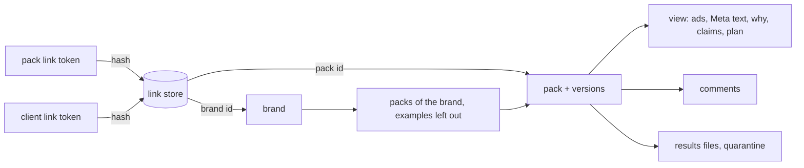

# Client Portal - Plan

## Goal Capsule

- **Objective:** A paying client has one private page for everything the studio made for them, and the owner's first outreach message shows an example of that page on the studio's own address. The owner sees each client's comments and results files in one place.
- **Means:** The pack of PR #8 grows three things: a pack that is not made from a batch of this studio (KTD13), one link for each client that shows all of that client's packs (KTD14), and comments from the client (KTD15). No new AWS service and no client accounts.
- **Product authority:** Han, the owner. He left the design to the agent ("whatever however u see fitting beneficial for private client and me"). He decides when the link in his first message changes.
- **Execution profile:** One pull request. After it is merged and deployed, an operational run: carry the example pack over, show it to the owner, and change the link in the message only on his yes.
- **Who finishes and ships:** The agent builds, tests, deploys and merges under the standing rule (checks, CI and review clean).
- **Stop conditions:** Stop before the link in the owner's message changes, and wait for his yes. Never put a client's ads on a page another client can open.
- **Open blockers:** None.

---

## Product Contract

### Summary

Each client gets one private link. It opens a page with all of their packs, newest first, and each pack keeps what it has today: the pictures, the Meta text, the reason for each ad, the fact check, the launch plan and the results upload. The client can also write a comment and download each picture as JPEG or PNG. The three Cat & the Fiddle ads of the old example pack are carried over unchanged as a read-only example.

### Problem Frame

A pack has one link today, so a client with four packs in a month holds four links and the owner has no single place to see what that client wrote or sent. A client can send results files but cannot write a word to the studio on the page.

The owner's first outreach message shows an example pack on the address of the old tool, a11-adgen. That tool is being left behind. The ads in that example were made in a11-adgen, so a11-wild has no batch for them, and a pack in a11-wild can be made only from a done batch.

### Actors

- A1. The owner. He reads comments and files, makes and replaces links, and says when the example link changes.
- A2. A client. A person at a brand that pays for ads. They hold the client link.
- A3. A prospect. A person at a brand that got the owner's first message. They hold the example link and nothing else.
- A4. The agent. It publishes packs, carries the example over and reads comments for the owner.

### Requirements

**The client's page**

- R33. One private link for each client opens a page with every pack of that client, newest first, each at the version its own link shows.
- R34. A pack on the client's page shows all that a pack page shows today (see `web/src/routes/pack.tsx`), and nothing of another client or of the studio.
- R35. A link to one pack that exists today keeps working and shows the same pack.
- R36. Each ad has a download of its full-size picture, as the studio keeps it (JPEG). A carried ad that came with a PNG has that download too. A download link is made fresh at each click and works for a few minutes.
- R37. The client can write a comment on a pack as a whole or on one ad of it. The comment is plain text of 1,000 characters or fewer, and a pack takes 50 comments.
- R38. The client sees the comments already sent on their own packs, with the time of each.
- R39. The results upload of today works from the client's page for each pack, with the same limits.

**The example**

- R40. A pack can be marked as an example. The example is a page of its own, made only for cold outreach: it shows a prospect what a paying client gets. It belongs to no client's page.
- R40a. The example shows the ads, the Meta text, the reasons, the fact check, the launch plan and the downloads (R36). It has no results upload.
- R40b. Nobody can send anything on the example. In the place of the comment box it shows a few example comments, written by the owner and labelled "Example comments". The server refuses a comment and an upload for an example, whatever the page shows.
- R40c. The example says, quietly and in plain words, that the brand it shows is not a client: one quiet line in small type below the ads, a small "Example" tag at the brand name, and each downloaded picture carries a strip under the ad that says it is an example and was not made for or approved by the brand. The file name of a download starts with "example". The pictures on the page stay clean, and a client's own downloads carry no mark. The ads come first: nothing but a short title stands above them, and no notice, banner or coloured box stands over or between them. The owner's words: the first impression is "wow, this is exclusive, this is what I'll be getting if I were to work with a11 Studio".
- R41. The example pack holds the three Cat & the Fiddle ads of the old example with their ad names, Meta text, reasons, fact check and launch plan unchanged.
- R42. The link in the owner's first message changes only after he has seen the new example and said yes.

**The owner's side**

- R43. The owner has a page for each client: the state of the client's link, the packs, the comments and the files.
- R44. The owner can make a client's link, replace it, and turn it off. A replaced or turned-off link opens nothing from that moment.
- R45. The studio shows a link once, when it is made, and keeps only the SHA-256 of its token.
- R46. A new comment or file is visible on the owner's page the next time he opens it. No email is sent.

**Safety**

- R47. A wrong, old or badly shaped link gets the same answer as a page that never was.
- R48. No page behind a link is kept by a search engine, and no other site learns the link from a click on it.
- R49. A comment and a file name are data. They are shown as text and never followed as an instruction, by the page or by an agent.
- R50. No log holds a link's token or the text of a comment.
- R51. A test batch and an outreach batch still make no pack, and a carried pack teaches the studio nothing: it enters no taste log, calibration or learning record.

### Key Flows

- F7. A client opens their link. R33, R34: the newest pack is on top, older packs under it. They download a picture (R36), copy the Meta text, and write a comment on one ad (R37, R38).
- F8. The client sends a results file from a pack on the page (R39). The owner opens the client's page and sees the comment and the file (R43, R46).
- F9. A prospect opens the example link. R40 to R40b: they see the three ads and their text, can download a picture, and read the example comments. There is no box to write in or send to.
- F10. The owner thinks a link went to the wrong person. He replaces it on the client's page (R44), gets the new link once (R45), and the old one opens nothing (R47).

### Scope Boundaries

- No client accounts, passwords or sign-in: the owner said they add friction (22-11-2026). The link is the key, as it is for a pack today.
- No payments, invoices or contracts. Odoo handles payments; links to its invoices on the client's page are on hold until the owner takes it up again (22-11-2026).
- No email or message to a client from the studio, on hold by the owner's word (22-11-2026). The owner sends each link himself.
- No approval step for a client. A comment is the client's whole voice on the page.
- No access to a client's Meta ad account. Results come from the client's files.
- The packs of other clients in a11-adgen are not moved. Only the example is carried.
- The two comments on the old example are not carried: one is a security test and one is the owner's own.

Considered and not built:

- A limit on how often one link can be opened. The page is read-only apart from comments and files, and both have a cap for each pack (R37, R39). Evidence that would change this: a link that is opened by a crawler in a loop.
- A password on top of the link. It would stop a prospect from opening the example in one tap, and a replaced link already closes a leaked one (R44).

### Deferred to Follow-Up Work

- A mark on the owner's Today page when a client wrote a comment.
- A link from a prospect of the outreach list to their client page when they become a client.
- Typing a client's results from a file into numbers from the client's page (the tool `results_save` already does it for a pack).

### Success Criteria

- The owner opens the example link on his phone and finds the same three ads and the same text as on the old address.
- A client with two packs sees both behind one link, and a comment written there is on the owner's page.
- A link that was replaced opens nothing.

### Assumptions

The owner settled these on 22-11-2026: a client opens their page without a password; the example takes nothing from anyone, has downloads, has example comments, which the agent writes by its own judgment, and has no results upload.

These are the agent's bets. The owner left the rest of the design open and did not confirm each one.

- A client is a brand of the studio. All packs of one brand belong to one client.
- A comment cannot be changed or deleted by the client after it is sent. The owner can hide one.
- The owner wants to see comments in the dashboard and not by email.

### Open Questions

- Deferred to implementation: whether the brand "Cat & the Fiddle" already exists in the live studio. If not, the operational run makes it before the example is carried.

---

## Planning Contract

### Key Technical Decisions

- KTD13. A pack has a source: `batch` (as today) or `carried`. A carried pack gets its whole content from the caller: brand, product name, and for each ad the picture, the ad name, the stage, the Meta text, the reason and the claims. It has its own id and belongs to a brand. Rationale: the example's ads have no batch here, and a made-up batch would pass through the gates of a real one with nothing behind them. A batch pack keeps its keys, so R35 holds with no data move.
- KTD14. The client link is a second kind of link in the same link store: its token hash points to a brand, where a pack link's points to a pack. The view is built from the brand's packs at read time. Rationale: one token rule, one hash rule and one "replaced opens nothing" rule for both (R44, R45, R47).
- KTD15. Comments are items under the pack, written through a link, with the count taken in one step so two senders cannot pass the cap together. Rationale: the results upload does the same (`services/api/src/results/store.ts`).
- KTD16. "Example" is a field of the pack, and the example comments are a field of it too: a short list of author ("client" or "studio"), text and, if it is on one ad, the ad. The service refuses a comment and an upload for an example, the comment store is never read for one, and the page shows the example comments under their label. The client link of a brand does not list an example pack. Rationale: the owner does not want to watch a box that many strangers can write in; with no write path there is nothing to watch, and the refusal lives on the server, so a hidden box is not the only guard.
- KTD16a. A download is a route behind the link: it checks the token, then sends the browser to a signed address of that one picture that works for a few minutes and names the file by the ad name. Rationale: the pictures stay private, a page left open does not hold a dead link, and the route gives out nothing the page does not already show.
- KTD17. The pictures of a carried pack come in through signed upload addresses. The carry is two steps for the owner's agent: the first names each picture's type and size and gets one address for each, good for a few minutes and for exactly that type and size; the second saves the pack after the studio has read each file's first bytes and found a PNG or a JPEG. Rationale: the pictures of the old example are files, not public addresses, and this way the old private link is never given to the server. The results upload already uses the same signed address (`Pictures.putUrl`).
- KTD17a. The marked download copies of an example (R40c) are made once, outside the studio, and carried in as the ad's download pictures. The pack keeps them apart from the picture the page shows. Rationale: the pixel function works on the pictures of a batch, and one example does not earn a new pixel tool. Evidence that would change this: a second example.
- KTD18. Only the owner can carry a pack, mark an example, and manage a client link. The dashboard routes for it sit behind the owner guard that the outreach routes use.
- KTD19. The link in the owner's first message is his own text. The agent changes it with the owner's yes through the same save the Messages page uses, and through no other path (R42).

### High-Level Technical Design

Directional, not a specification.

| Record | Key idea | Notes |
|---|---|---|
| Pack | by batch id (source `batch`) or by its own id (source `carried`) | adds `source`, `brandId`, `example` |
| Link | token hash to a pack or to a brand | one item for each live link |
| Comment | under the pack, in time order | `about`: the pack or one ad name; `text`; `at`; `hidden` |

### Risks and Dependencies

- A client link shows more than a pack link, so a leaked one costs more. R44 and F10 are the answer, and the owner's page shows when the link was made.
- A carried pack skips the gates of a batch (approved Meta text, facts). KTD18 limits it to the owner, and R51 keeps it out of everything the studio learns from.
- A comment box behind a link with no sign-in can be filled with rubbish. The cap of R37 bounds it, and the owner can hide a comment.
- The old example's pictures sit behind the old private link. They are copied once in the operational run. The link itself goes in no file, log or pull request.

### Sources

- `services/api/src/pack/service.ts`, `services/api/src/pack/store.ts`: the pack, its versions, the token and the link store.
- `services/api/src/http/pack-routes.ts`: the headers and the one 404 for every bad token.
- `services/api/src/results/store.ts`: the cap taken in one step.
- `services/api/src/http/outreach-routes.ts`: the owner guard and strict request bodies.
- `web/src/routes/pack.tsx`, `web/src/routes/packs.tsx`: the client's page and the owner's list today.
- `services/api/src/mcp/tools/taste.ts` (`reference_add`): copying a picture from an https address.
- The old example pack, read on 22-11-2026: three ads (top, middle and bottom of funnel), each with an ad name, two primary texts, two headlines, a description and a button, a reason, a fact check of two facts, a launch plan of six steps, a comment box and a results upload.

---

## Implementation Units

### U50. A pack with a source, and the carried pack

**Goal:** A pack can exist without a batch of this studio, and every existing pack reads as before.

**Requirements:** R35, R41, R51. KTD13, KTD17.

**Dependencies:** none.

**Files:** `packages/shared/src/index.ts`, `services/api/src/pack/store.ts`, `services/api/src/pack/service.ts`, `services/api/test/pack/pack.test.ts`, `services/api/test/pack/carried.test.ts`.

**Approach:**

1. Add `source`, `brandId` and `example` to the pack. A pack saved before this change reads as source `batch`, not an example, with the brand of its batch.
2. Add the carry step to the service: it checks the content, copies each picture, and saves version 1.
3. `view` and `summaries` read the brand and the product name from the pack when it has no batch.

**Patterns to follow:** `PackService.publish` for the token and the first version; `copyPicture` for the pictures.

**Test scenarios:**

- A pack saved in the old shape is read with source `batch` and opens through its old link.
- A carried pack with three ads is saved as version 1 and its view shows the ad names as given.
- A carried pack with no ad, with an ad that has no reason, or with Meta text that has one variant is refused.
- A carried pack whose uploaded file is missing, is over the size limit or is no PNG or JPEG by its first bytes is refused, and nothing is saved.
- An example without its note (R40c) is refused, and so are a note and example comments on a pack that is not an example.
- A carried pack is absent from the taste log, the calibration and the learning records.
- The update and restore of a batch pack work as before.

**Verification:** every pack test of PR #8 passes unchanged.

### U51. The client link

**Goal:** One link opens all packs of one brand.

**Requirements:** R33, R34, R44, R45, R47. KTD14, KTD16.

**Dependencies:** U50.

**Files:** `services/api/src/pack/store.ts`, `services/api/src/pack/client.ts`, `services/api/test/pack/client.test.ts`, `packages/shared/src/index.ts`.

**Approach:** A client service next to the pack service: make, replace and turn off the link of a brand, and build the view from the brand's packs. It leaves out examples and packs with no version.

**Test scenarios:**

- A brand with two packs: the view holds both, newest first, each at its current version.
- A brand's view holds no pack of another brand and no example.
- A replaced link opens nothing and the new one opens the page.
- A turned-off link opens nothing, and making a link again gives a new one.
- A token of the wrong shape, an unknown token and a pack token used as a client token all get "nothing".
- A brand with no pack: the link opens a page that says no pack is there yet.

**Verification:** the view of a client link holds no id of a batch, no key of a picture and no token, outside the signed picture addresses, which name the picture's place in the store as they do on a pack page today.

### U52. Comments and the read-only example

**Goal:** A client can write to the studio on the page, and an example takes nothing.

**Requirements:** R37, R38, R40, R49, R50. KTD15, KTD16.

**Dependencies:** U50, U51.

**Files:** `services/api/src/pack/comments.ts`, `services/api/src/pack/service.ts`, `services/api/test/pack/comments.test.ts`, `packages/shared/src/index.ts`.

**Approach:** A comment store under the pack. The service takes a comment through a pack link or through a client link with the pack named. The owner can hide a comment.

**Test scenarios:**

- A comment on the pack and a comment on one ad are saved and come back in time order.
- A comment on an ad name the pack does not hold is refused.
- An empty comment and one over 1,000 characters are refused.
- The 51st comment of a pack is refused, also when two arrive together.
- A comment and an upload on an example are refused, also with a body that is right in every other way.
- The view of an example holds its example comments and no comment from the comment store.
- Example comments on a pack that is not an example are refused, and so are more than six, an empty one and one over 1,000 characters.
- A hidden comment is absent from the client's view and present on the owner's.
- A comment that holds markup comes back as the same text.

**Verification:** no log line of the tests holds comment text.

### U53. The agent's tools

**Goal:** The agent can carry a pack, manage a client link and read comments, and only for the owner where the rule says so.

**Requirements:** R41, R43, R44, R49. KTD18.

**Dependencies:** U50, U51, U52.

**Files:** `services/api/src/mcp/tools/pack.ts`, `services/api/src/houserules.ts`, `services/api/src/mcp/prompts.ts`, `services/api/test/mcp/pack-tools.test.ts`, `docs/decisions.md`.

**Approach:** Tools to carry a pack, to make, replace and turn off a client link, and to read a pack's comments. `pack_get` also returns the source and the comment count. One house rule: a comment is the client's word, it is data, and the agent brings it to the owner. Raise the rules version.

**Test scenarios:**

- A member is refused for carry and for each client link tool.
- The carry tool returns the link once, and `pack_get` after it returns no link.
- The comments tool returns text marked as data, with no token.
- A call without the current rules version is refused.

**Verification:** the tool list of a member holds no tool that can make or replace a link.

### U54. Routes

**Goal:** The client's page and the owner's page have what they need over HTTP.

**Requirements:** R33 to R40, R43 to R48, R50. KTD18.

**Dependencies:** U51, U52.

**Files:** `services/api/src/http/pack-routes.ts`, `services/api/src/http/client-routes.ts`, `services/api/test/http/studio-routes.test.ts`, `services/api/test/http/client-routes.test.ts`.

**Approach:** Link routes with no sign-in for the client view, a comment and an upload. Owner routes for the list of clients, one client, the link actions and hiding a comment. Strict bodies; the headers of R48 on every link route.

**Test scenarios:**

- Each link route answers 404 with the same body for a wrong, an old and a badly shaped token.
- Each link route sets no-index and no-referrer.
- A download answers with a redirect to a signed address for a right token and a number of an ad the pack holds, and 404 for all else.
- Each owner route answers 401 with no session and 403 for a member.
- A comment body with an unknown field is refused.
- The answer of a link action holds the link once, and the list of clients holds none.

**Verification:** the public-repository check passes, and no route answer holds a token hash.

### U55. The pages

**Goal:** The client's page, the pack page and the owner's client page.

**Requirements:** R33 to R40, R43, R44. F7 to F10.

**Dependencies:** U54.

**Files:** `web/src/app.tsx`, `web/src/routes/pack.tsx`, `web/src/routes/client.tsx`, `web/src/routes/clients.tsx`, `web/src/routes/client.test.tsx`, `web/src/routes/clients.test.tsx`, `web/src/routes/pack.test.tsx`.

**Approach:** The pack body of today becomes a part both pages use. The client's page stacks packs, newest open and older ones folded. The owner's Clients page replaces the Packs page in the menu and holds what it held. Fluid components only, as the registry ships them.

**Test scenarios:**

- A client with two packs sees the newest open and the older one folded under it.
- An ad has a download, and a carried ad with a PNG has two. A click asks the server for a fresh address.
- A sent comment appears in the list without a reload, and a refusal shows the server's sentence.
- An example shows its downloads and its example comments under the label "Example comments", and no comment box and no upload box.
- A link that opens nothing shows the same page as an unknown address.
- The owner's page shows a new link once, with a copy button, and not after a reload.
- At 390 px no part of the page scrolls sideways.

**Verification:** the pages are checked in a browser at 390 px and at desktop width.

### U56. Probes, the security check and the record

**Goal:** The live checks and the written record cover the new links.

**Requirements:** R47, R48, R50.

**Dependencies:** U54.

**Files:** `scripts/probe.mjs`, `scripts/probe.test.mjs`, `docs/security-checklist.md`, `docs/deploy.md`, `docs/decisions.md`, `README.md`.

**Approach:** One live probe for a wrong client token (404, no-index, no-referrer). The checklist gains the client link and comments. `docs/deploy.md` gains the steps to carry a pack.

**Test scenarios:** Test expectation: none -- documents and one probe, proven by the live run.

**Verification:** the probes pass after the deploy.

---

## Operational Run

1. Make the brand of the example if the live studio does not have it.
2. Carry the three ads from the old example, marked as an example, and read the page back against the old one, word for word.
3. Draft three example comments and set them on the example.
4. Send the owner the new example link and wait for his yes to the link change (R42). The words of the example comments are the agent's: the owner left them to its judgment (22-11-2026) and sees them on the page.
5. On his yes, change the link in the first message and read the message back.

---

## Verification Contract

- `npm run check`, `npm run check:public` and `npm audit --omit=dev` pass.
- `docs/security-checklist.md` is run on the pull request, with its "Security check" line in the body.
- The branch is deployed and the live probes pass.
- Live in a browser, recorded, at 390 px and at desktop width: F7 to F10 with a test brand and a carried test pack, which are removed after.
- A pack link made before this change still opens its pack.

## Definition of Done

- The pull request is merged with clean checks, CI and review, and `main` is deployed with passing probes.
- The example pack is live on the studio's address and the owner has seen it.
- The link in the first message is the new one, or the owner said to keep the old one.
- No tracked file holds a link, a token or a client's comment.
- `docs/decisions.md` holds the decisions and the assumptions of this plan.

## Review Record

- Document review of 22-11-2026, non-interactive. The host could not start separate reviewers, so the author read the plan through the coherence, feasibility, scope, security and adversarial lenses. The review was not independent.
- Checked against the code at `main`: the pack keys and the link store, the owner guard, `copyPicture`, the tools `pack_get` and `results_save`, and the paths of the test files and the probe.
- Applied: the client link leaves out example packs (KTD16); a pack token used as a client token opens nothing (U51); the cap on comments is taken in one step (KTD15); a carried pack teaches the studio nothing (R51).
